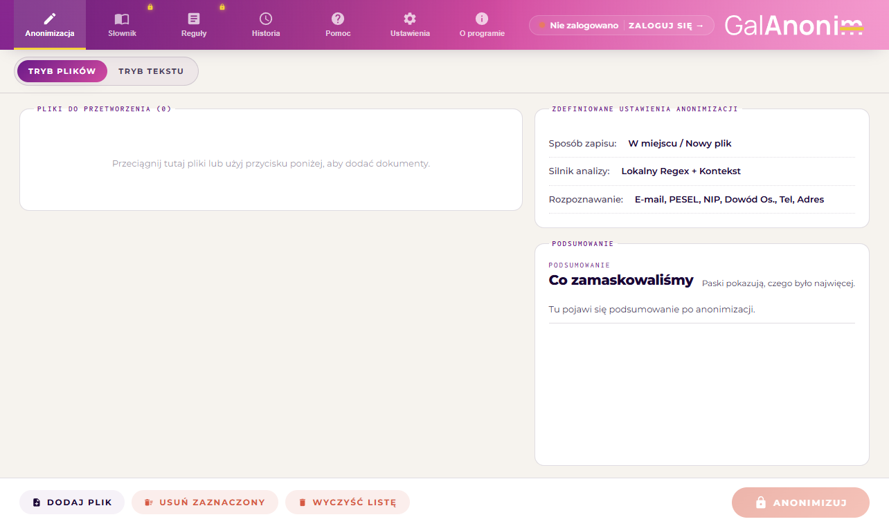

<p align="center">
  
</p>

<h1 align="center">GalAnonim — Bezpieczna Anonimizacja Dokumentów (Windows)</h1>

<p align="center">
  <strong>Profesjonalna, w 100% lokalna ochrona danych osobowych i poufnych (RODO / GDPR / AI Act) w dokumentach biurowych.</strong><br>
  Bezpiecznie przygotuj dokumenty przed przesłaniem do modeli AI (ChatGPT, Copilot, Claude, Gemini) lub przed publikacją.
</p>

<p align="center">
  <a href="https://github.com/zeslownikiem/galanonim-release/releases/latest"></a>
  
  
  
  
  
</p>

<p align="center">
  <a href="https://github.com/zeslownikiem/galanonim-release/releases/latest">
    
  </a>
</p>

---

## 📸 Podgląd Aplikacji

<p align="center">
  
</p>

---

## 🎯 Czym jest GalAnonim?

**GalAnonim** to wyspecjalizowana aplikacja desktopowa dla systemu Windows, zaprojektowana z myślą o prawnikach, urzędnikach, analitykach, przedsiębiorstwach oraz osobach prywatnych, które przetwarzają dokumenty zawierające dane osobowe lub informacje poufne.

W dobie powszechnego korzystania z narzędzi sztucznej inteligencji (ChatGPT, Microsoft Copilot, Claude, Gemini) oraz rygorystycznych wymogów prawnych (**RODO / GDPR**, **AI Act**), ręczne maskowanie danych jest powolne i podatne na błędy, a korzystanie z narzędzi chmurowych wiąże się z ryzykiem wycieku danych.

> 🔒 **Gwarancja 100% prywatności (Privacy-by-Design):**  
> W przeciwieństwie do rozwiązań chmurowych, **GalAnonim wykonuje całą analizę, OCR i maskowanie w 100% lokalnie na Twoim komputerze**. Żaden dokument, tekst, imię ani numer PESEL nigdy nie opuszczają Twojego urządzenia!

---

## ✨ Kluczowe Możliwości

### 📑 Obsługa Popularnych Formatów Biurowych
| Format | Metoda Przetwarzania | Specyfikacja i Gwarancje |
| :--- | :--- | :--- |
| **DOCX** (`.docx`) | `DocumentFormat.OpenXml` | Pełna analiza struktury dokumentu Word (paragrafy, tabele, nagłówki, stopki). Algorytm proporcjonalnej redystrybucji znaków zapobiega rozjeżdżaniu się układu tekstu i tabel. |
| **ODT** (`.odt`) | Bezpośrednia manipulacja XML | Ekstrakcja i sanitizacja pliku `content.xml` w archiwum OpenDocument z zachowaniem stylów i formatowania LibreOffice / OpenOffice. |
| **PDF** (`.pdf`) | `Docnet.Core` & Redakcja fizyczna | Wyliczanie współrzędnych `BoundingBox` i **trwała graficzna redakcja** (nieusuwalne czarne prostokąty) bez pozostawiania niewidocznych warstw tekstowych. |
| **PDF Skany** (`.pdf`) | Silnik `Tesseract OCR v5` | Automatyczna detekcja zeskanowanych stron i obrazów rastrowych. Ekstrakcja tekstu polskim modelem `pol.traineddata` i precyzyjne maskowanie współrzędnych. |
| **TXT** (`.txt`) | Strumieniowy proces UTF-8 | Błyskawiczna anonimizacja plików tekstowych ze standaryzacją kodowania znaków. |

### 🧠 Zaawansowany Hybrydowy Silnik Detekcji
* **Identyfikatory urzędowe z walidacją sum kontrolnych:**
  * **PESEL** — weryfikacja wag algorytmu, poprawności stulecia oraz daty urodzenia.
  * **NIP** — walidacja wag algorytmu Urzędów Skarbowych.
  * **Numer Dowodu Osobistego** — weryfikacja serii 3 liter i cyfr z wagami kontrolnymi.
* **Dane kontaktowe i finansowe:**
  * Rachunki bankowe **IBAN**,
  * Adresy e-mail,
  * Numery telefonów (polskie komórkowe, stacjonarne, z prefiksem `+48` i międzynarodowe),
  * Kody pocztowe (`XX-XXX`).
* **Morfologia i Fleksja języka polskiego:**
  * Wbudowany silnik **Morfeusz 2** ze **Słownikiem Gramatycznym Języka Polskiego (SGJP)** — deklinacja imion, nazwisk, miast i ulic we wszystkich przypadkach gramatycznych (*mianownik, dopełniacz, celownik, biernik, narzędnik, miejscownik, wołacz*).
* **Heurystyki Poszlakowe:**
  * Wykrywanie nieznanych nazwisk występujących po imionach lub inicjałach.
  * Analiza granic zdań i polskich partykuł zapobiegająca fałszywym dopasowaniom na początku zdania.
* **Pełna Personalizacja:**
  * Możliwość definiowania własnych reguł wyrażeń regularnych (**Custom Regex**).
  * Możliwość dodawania własnych słów i fraz w dedykowanej zakładce słownika.

### ⚡ Dwa Tryby Pracy
1. **Tryb Plików:** Przeciągnij i upuść (Drag & Drop) całe dokumenty lub foldery. Opcja zapisu „w miejscu” lub bezpiecznego zapisu jako nowa kopia z sufiksem (np. `dokument_anonimizowany.docx`).
2. **Tryb Tekstu:** Błyskawiczne wklejanie tekstu ze schowka, natychmiastowa anonimizacja z podglądem i skopiowanie oczyszczonego tekstu jednym kliknięciem.

### 🛡️ Bezpieczeństwo i Architektura
* **Szyfrowana Baza Słowników:** Fabryczna baza słów jest dystrybuowana w bezpiecznym formacie AES-256-GCM.
* **Ochrona Danych Użytkownika:** Aktualizacje słownika automatycznie przenoszą reguły użytkownika (`CarryOverUserData`).
* **14-dniowy Bufor Offline (Grace Period):** Aplikacja działa bez konieczności ciągłego połączenia z siecią, a tokeny autoryzacyjne są chronione mechanizmem Windows DPAPI (`CurrentUser`).

---

## 📥 Pobieranie i Instalacja

### Krok 1: Pobranie Instalatora
Pobierz najnowszą wersję instalatora z sekcji wydań:  
👉 **[Pobierz GalAnonim_Setup.exe (Najnowsze Wydanie)](https://github.com/zeslownikiem/galanonim-release/releases/latest)**

### Krok 2: Uruchomienie Instalatora
1. Uruchom pobrany plik `GalAnonim_Setup_X.Y.Z.exe`.
2. **Komunikat Windows Defender SmartScreen:**  
   Ponieważ GalAnonim jest nowym, niezależnym oprogramowaniem dla systemu Windows, filtr SmartScreen może wyświetlić niebieski ekran ostrzegawczy (*„System Windows ochronił ten komputer”*):
   * Kliknij link **„Więcej informacji”** (More info).
   * Kliknij przycisk **„Uruchom mimo to”** (Run anyway).
3. Postępuj zgodnie z instrukcjami asystenta Inno Setup. Program automatycznie zainstaluje niezbędne biblioteki oraz utworzy skrót na Pulpicie i w Menu Start.

> 💡 **Cicha instalacja dla administratorów IT:**  
> ```powershell
> GalAnonim_Setup_X.Y.Z.exe /VERYSILENT /SUPPRESSMSGBOXES /NORESTART
> ```

---

## 💻 Wymagania Systemowe

| Parametr | Minimalne Wymagania | Zalecane Wymagania |
| :--- | :--- | :--- |
| **System Operacyjny** | Windows 10 (wersja 1809 lub nowsza, 64-bit) | Windows 11 (64-bit) |
| **Architektura** | x64 (64-bit) | x64 (64-bit) |
| **Pamięć RAM** | 2 GB | 4 GB lub więcej (zalecane przy OCR dużych plików PDF) |
| **Miejsce na Dysku** | 150 MB wolnego miejsca | 500 MB wolnego miejsca |
| **Komponenty** | Microsoft Edge WebView2 Runtime | WebView2 (wbudowany w Windows 11) |

---

## ❓ Najczęściej Zadawane Pytania (FAQ)

<details>
<summary><strong>Czy moje dokumenty są gdziekolwiek wysyłane przez Internet?</strong></summary>

**Absolutnie nie.** Wszystkie operacje — odczyt dokumentu, podział na słowa, silnik Morfeusz 2, OCR Tesseract, nałożenie masek oraz zapis pliku — wykonywane są wyłącznie lokalnie w procesie aplikacji na Twoim komputerze.
</details>

<details>
<summary><strong>Dlaczego Windows SmartScreen wyświetla ostrzeżenie przy uruchomieniu instalatora?</strong></summary>

Microsoft SmartScreen wyświetla ostrzeżenie dla każdego nowego pliku wykonywalnego `.exe`, który nie zgromadził jeszcze historii pobrań u setek tysięcy użytkowników i nie posiada drogiego certyfikatu korporacyjnego EV. Jest to standardowa procedura dla oprogramowania w fazie rozwojowej. Plik instalatora jest bezpieczny i kompilowany automatycznie w publicznym środowisku CI/CD.
</details>

<details>
<summary><strong>Czy GalAnonim wymaga stałego połączenia z Internetem?</strong></summary>

Nie. GalAnonim został zaprojektowany z myślą o pełnej pracy offline. Połączenie internetowe jest opcjonalne i służy wyłącznie do jednorazowego logowania kontem galanonim.pl lub pobierania aktualizacji słowników fleksyjnych. Po zalogowaniu aplikacja oferuje 14-dniowy bufor pracy całkowicie offline.
</details>

<details>
<summary><strong>Gdzie znajdują się logi diagnostyczne aplikacji w razie wystąpienia błędu?</strong></summary>

Logi zapisywane są w folderze profilu użytkownika:  
`%LOCALAPPDATA%\GalAnonim\logs\`  
Możesz je otworzyć, wpisując powyższą ścieżkę w pasku adresu Eksploratora Plików lub w oknie *Uruchom* (`Win + R`).
</details>

---

## 🌐 Przydatne Linki i Pomoc

* 🌐 **Strona główna projektu:** [galanonim.pl](https://galanonim.pl)
* 📦 **Wszystkie wydania instalatora:** [GitHub Releases](../../releases)
* 🐛 **Zgłaszanie błędów:** [Otwórz zgłoszenie błędu](../../issues/new?template=bug_report.yml)
* 💡 **Propozycje nowych funkcji:** [Zaproponuj ulepszenie](../../issues/new?template=feature_request.yml)
* ✉️ **Kontakt e-mail:** [kontakt@galanonim.pl](mailto:kontakt@galanonim.pl)

---

### 🌍 English Summary

**GalAnonim** is a high-performance Windows desktop application designed for **100% on-device anonymization and redaction** of office documents (DOCX, ODT, PDF with OCR, and TXT). It automatically identifies and redacts personal data (GDPR / RODO compliance, PII, national ID numbers like PESEL/NIP, IBANs, names, and addresses) with advanced Polish morphological analysis (Morfeusz 2 + SGJP) and physical PDF redaction. All document processing is performed entirely offline on your local machine.

* **Download Latest Installer:** [Releases Page](../../releases/latest)
* **Supported OS:** Windows 10 / 11 (64-bit)

---

<p align="center">
  <sub>© 2026 GalAnonim · Bezpieczna Anonimizacja Dokumentów</sub>
</p>
